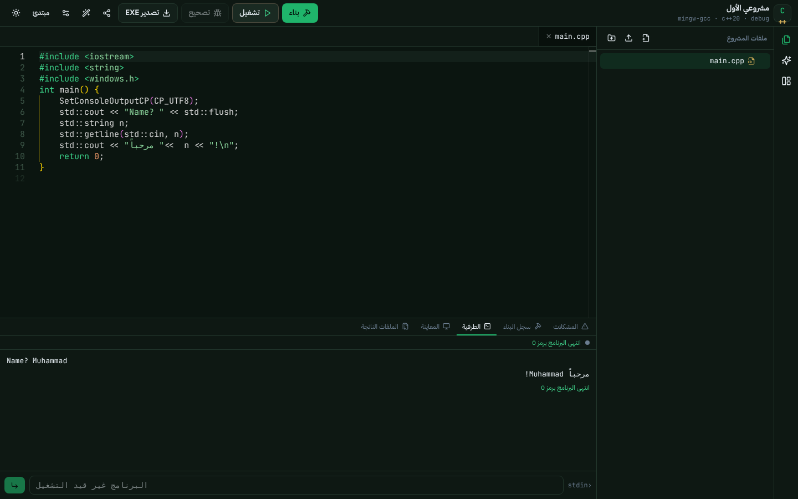
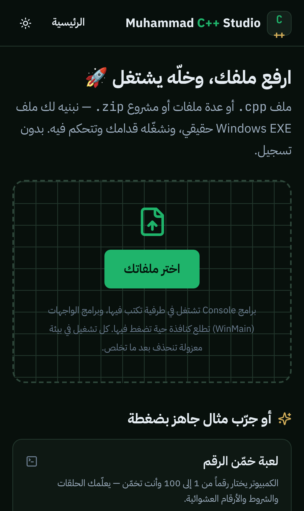
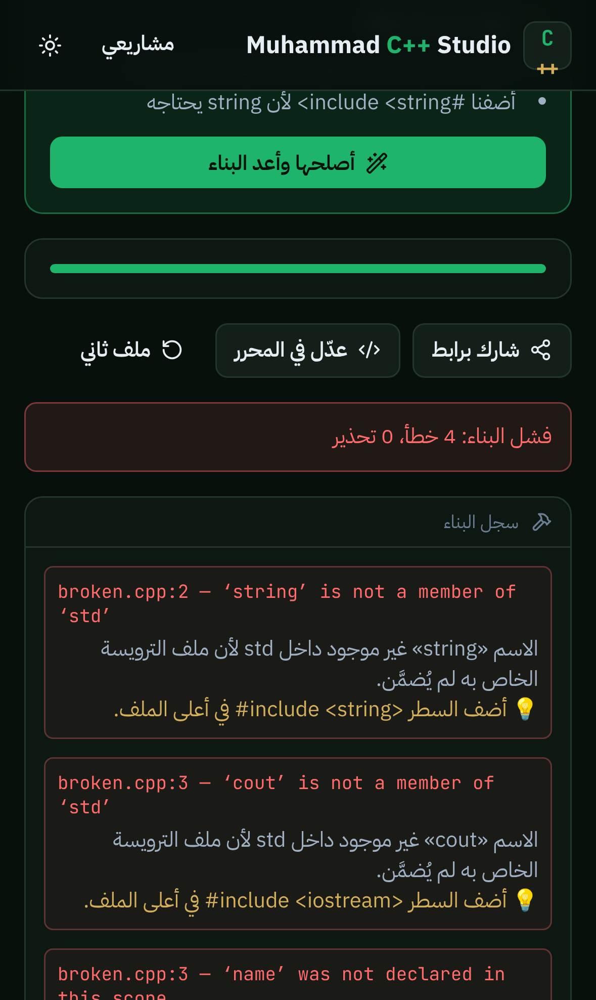
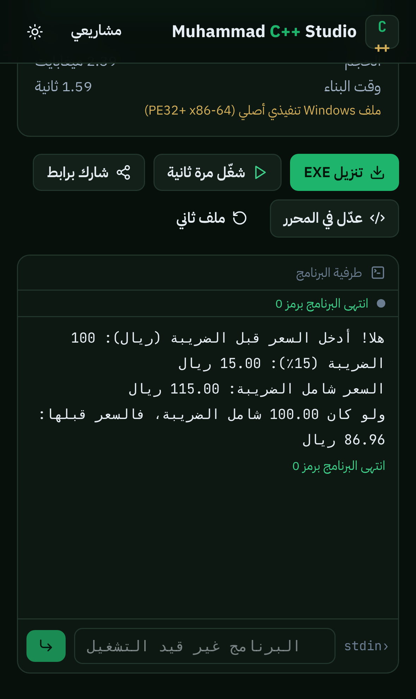

# Muhammad C++ Studio 🇸🇦

منصة تطوير C++ عربية تعمل من المتصفح (الكمبيوتر والجوال): أنشئ مشروعاً أو ارفعه، حرّر الكود في محرر احترافي، اضغط **بناء** لتحصل على ملف **Windows EXE حقيقي**، ثم نزّله أو شغّله وتفاعل معه من المتصفح.

[](https://codespaces.new/moha700m/Labpython/tree/main?quickstart=1)

> An Arabic-first, browser-based C++ IDE: edit, build real Windows `.exe` files on isolated workers, download them, or run and interact with them from the browser.



## 💻 برنامج ويندوز كامل (Setup.exe)

### ⬇️ [تنزيل MuhammadCppStudio-Setup.exe](https://github.com/moha700m/Labpython/releases/latest/download/MuhammadCppStudio-Setup.exe)

1. نزّل الملف وشغّله (لو طلعت «Windows protected your PC» اضغط **More info ← Run anyway** — الملف غير موقّع رقمياً).
2. Next ← Install. ما يحتاج صلاحيات مدير، ولا Docker، ولا أي تثبيت ثاني.
3. يفتح الاستديو في المتصفح تلقائياً، ويطلع لك أيقونة **Muhammad C++ Studio** على سطح المكتب.

داخل البرنامج: مترجم **MinGW-w64 (GCC)** و**CMake** مدمجين، والبرامج اللي تبنيها **تشتغل على جهازك مباشرة** — برامج الواجهات تفتح كنافذة ويندوز حقيقية. للإغلاق: زر «إيقاف وإغلاق» في نافذة الاستديو الصغيرة.

> كل نسخة تُبنى وتُختبر تلقائياً على ويندوز حقيقي في GitHub Actions قبل نشرها (بناء EXE، CMake، تشغيل Console وواجهة رسومية).

### بديل: الاستديو كامل عبر Docker (ويندوز / ماك / لينكس)

ثبّت **Docker Desktop**، نزّل **[Labpython-main.zip](https://github.com/moha700m/Labpython/archive/refs/heads/main.zip)**، فك الضغط، ودبل كليك على **`Start-Studio.bat`** (ماك/لينكس: `./start-studio.sh`). يفتح على **http://localhost:4000/run/**، وللإيقاف **`Stop-Studio.bat`**.

## 🚀 شغّل المنصة على GitHub بضغطة واحدة

1. اضغط زر **Open in GitHub Codespaces** أعلاه، ثم **Create codespace**.
2. انتظر أول مرة 5–8 دقائق (يثبّت المترجمات وWine ويبني الموقع). لا تقفل الصفحة.
3. بيفتح لك تلقائياً ملف **«👇 اضغط الرابط لفتح الموقع»** — اضغط الرابط الأخضر.
4. إذا طلب تسجيل دخول GitHub سجّل، وبيفتح لك الموقع على صفحة `/run/`.

**من الجوال:** نفس الخطوات. ولو ما شفت الملف: القائمة ☰ ← Terminal ← New Terminal، واكتب `bash .devcontainer/start.sh`، والرابط يطلع في آخر سطر.

**المرة الجاية:** من https://github.com/codespaces افتح نفس الـ Codespace، والموقع يشتغل لحاله خلال ثواني. الـ Codespace مجاني ضمن حصة حسابك الشهرية، ويطفي لحاله إذا ما استخدمته فترة.

<p align="center">  </p>

## ما الذي يعمل الآن (مُختبر فعلياً)

| الميزة | الحالة |
|---|---|
| واجهة عربية RTL كاملة، داكن/فاتح، متجاوبة مع الجوال | ✅ |
| حسابات، مشاريع، ملفات متعددة، تبويبات، حفظ تلقائي | ✅ |
| رفع ZIP / مجلد / ملفات مع حماية من Path Traversal وZIP bombs والروابط الرمزية | ✅ |
| محرر Monaco: تلوين، إكمال تلقائي لـ C++، تنسيق (clang-format)، بحث واستبدال، اختصارات | ✅ |
| بناء GCC وClang (Linux ELF) وMinGW-w64 (Windows PE32+ EXE حقيقي) | ✅ |
| C++17 / 20 / 23، و C++26 حسب دعم المترجم (Clang 18 نعم، GCC 13 لا — مع شرح) | ✅ |
| ملف واحد، ملفات متعددة، CMake، Makefile، مكتبات ساكنة وديناميكية، ملفات .rc | ✅ |
| سجل بناء حي، نسبة تقدم، وقت، حجم، SHA-256، صيغة الملف المكتشفة من الترويسة | ✅ |
| الأخطاء والتحذيرات داخل الكود مع شرح عربي واقتراح إصلاح | ✅ |
| تنزيل EXE | ✅ |
| تشغيل برامج Console تفاعلياً من المتصفح (Linux معزول، أو EXE عبر Windows Runner) | ✅ |
| معاينة حية لبرامج Win32 الرسومية مع الماوس ولوحة المفاتيح ولقطة شاشة | ✅ (عبر Wine، انظر الملاحظات) |
| وضع تعليمي: دروس وتمارين يُتحقق منها بالبناء والتشغيل الفعلي | ✅ |
| صفحة «ارفع ملفك وشغّله» (`/run/`): رفع ← بناء EXE ← تشغيل وتحكم ← تنزيل، مع كشف تلقائي لبرامج WinMain | ✅ |
| **بدون تسجيل**: دخول ضيف بضغطة (مناسب للجوال) | ✅ |
| **إصلاح تلقائي ذكي**: ترويسات ناقصة، `;` ناقصة، `void main`، تعارض Console/WinMain — بموافقتك ثم إعادة البناء | ✅ |
| **مشاركة برابط**: لقطة عامة للقراءة فقط، وأي أحد يشغّل نسخته بضغطة | ✅ |
| **أمثلة سعودية جاهزة**: ضريبة القيمة المضافة 15٪، الزكاة، التاريخ الهجري، خمّن الرقم، مسبحة إلكترونية (واجهة Windows) | ✅ |
| هوية سعودية: الأخضر والذهبي، ولغة ودّية | ✅ |
| تشغيل المنصة كاملة على GitHub Codespaces | ✅ مُختبر داخل نفس صورة Codespaces محلياً |
| مساعد ذكاء اصطناعي عربي بموافقة على كل تعديل (عرض الفروقات) | ✅ مبني — يحتاج مفتاح مزوّد على الخادم |
| Debugging / Breakpoints / Profiling / Git | ⏳ لم يُنفّذ بعد (الزر معطّل ومعلَن كذلك) |
| MSVC وWindows Worker أصلي | ⏳ موثّق فقط — يحتاج بنية Windows |

**ملاحظة صريحة عن «Windows Runner»:** التشغيل الحالي يتم عبر **Wine** داخل صندوق رمل على عامل Linux، وليس على نظام Windows حقيقي. ملفات EXE نفسها أصلية (PE32+) وتعمل على Windows، لكن Wine لا يغطي كل واجهات Windows. تصميم العامل الأصلي على Windows موثّق في [`workers/windows-runner/README.md`](workers/windows-runner/README.md).

## البدء السريع (تطوير محلي)

المتطلبات: Node.js 22.12+، pnpm 10، و(للبناء والتشغيل) `bubblewrap g++ clang cmake g++-mingw-w64-x86-64-posix` و(اختياري) `wine xvfb xdotool imagemagick clang-format`.

```bash
pnpm install
pnpm --filter @mcs/web build                      # واجهة ثابتة
MCS_WEB_DIR=$PWD/apps/web/out pnpm --filter @mcs/api start   # http://localhost:4000
# في طرفية أخرى (الرمز يُنشأ تلقائياً في .data/worker-token أثناء التطوير):
export MCS_WORKER_TOKEN=$(cat apps/api/.data/worker-token)
pnpm --filter @mcs/linux-builder start
pnpm --filter @mcs/windows-runner start
```

التفاصيل في [DEVELOPMENT.md](DEVELOPMENT.md)، النشر في [DEPLOYMENT.md](DEPLOYMENT.md)، المعمارية في [ARCHITECTURE.md](ARCHITECTURE.md)، الأمن في [SECURITY.md](SECURITY.md)، وحالة المشروع في [PROJECT_STATE.md](PROJECT_STATE.md).

## الاختبارات

```bash
pnpm lint && pnpm typecheck
pnpm test:unit          # منطق خالص
pnpm test:security      # عزل المستخدمين، هجمات الرفع، حدود الصندوق الرملي
pnpm test:integration   # بناء وتشغيل حقيقي عبر API + العمال
node tests/e2e/run-e2e.mjs   # واجهة حقيقية عبر Playwright (يتطلب تشغيل المكدّس)
```

## البنية

```
apps/api            Fastify API: مصادقة، مشاريع، طابور مهام، تخزين ملفات ناتجة، ترحيل جلسات التشغيل
apps/web            Next.js (تصدير ثابت) + Tailwind + Monaco
packages/shared     الأنواع، فحص المسارات، ZIP الآمن، كشف صيغة الملفات التنفيذية
packages/compiler   تخطيط البناء، قائمة الخيارات المسموحة، تحليل رسائل المترجم
packages/localization  النصوص العربية وشرح الأخطاء
packages/worker-runtime  الصندوق الرملي (bubblewrap)، بروتوكول العامل، جلسات التشغيل
workers/linux-builder   عامل البناء (GCC/Clang/MinGW) + تشغيل Linux
workers/windows-runner  عامل تشغيل EXE (Wine + Xvfb) ووثائق العامل الأصلي
workers/windows-builder وثائق عامل MSVC (غير منفّذ)
templates/          قوالب المشاريع
infrastructure/docker  Dockerfiles و docker-compose
tests/              unit / security / integration / e2e
```

## الرخصة

[MIT](LICENSE). المكتبات الخارجية المستخدمة وتراخيصها مذكورة في [SECURITY.md](SECURITY.md#third-party-components).
